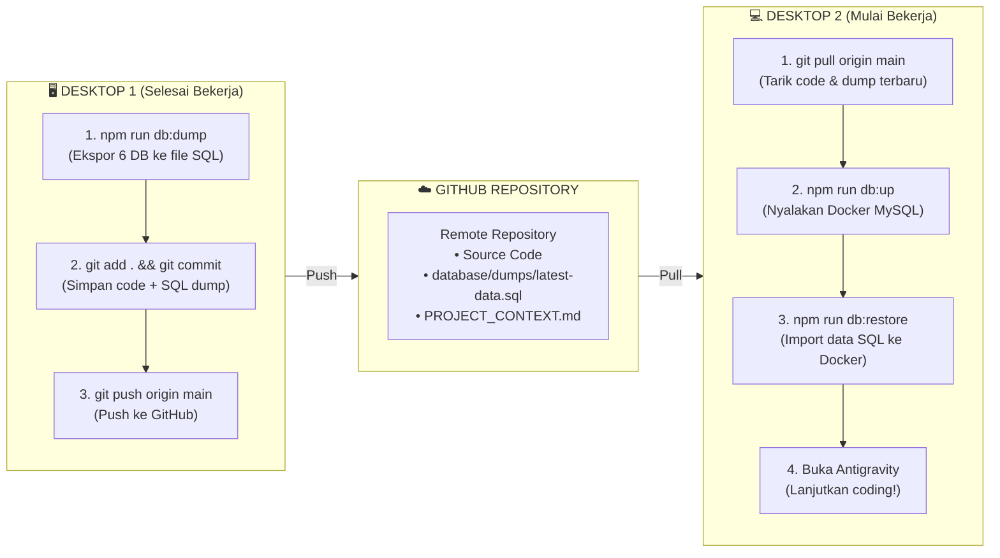

# Panduan Sinkronisasi HomeHub Antar 2 Desktop (Database & AI Antigravity)

Panduan ini menjelaskan cara mudah bekerja dari 2 komputer/desktop berbeda secara mulus (*seamless*), mencakup sinkronisasi **Source Code**, **Database di Docker Container**, dan **Konteks AI Antigravity**.

---

## 📌 Mengapa Database Docker Tidak Otomatis Masuk ke GitHub?

Docker menyimpan data MySQL di dalam **Docker Volume** lokal (`mysql_data`), bukan di dalam folder project biasa. File biner database MySQL (`.ibd`, `ibdata1`) memang **tidak boleh di-push langsung ke Git** karena:
1. Ukurannya besar dan terus berubah tiap detik.
2. Sangat rentan korup jika ditransfer antar mesin dengan OS / arsitektur CPU berbeda (misal: Mac Apple Silicon M-series vs Windows/Linux x86).
3. Terkunci oleh proses MySQL (*file lock*).

**Solusinya**: Menggunakan skrip ekspor teks SQL (**SQL Dump**) yang sudah kami sediakan di dalam project!

---

## 🛠️ Alur Kerja Sinkronisasi (Workflow)



---

## 1. Langkah di Komputer Asal (Desktop 1) Sebelum Pindah

Setiap kali Anda selesai bekerja di Desktop 1 dan ingin pindah ke Desktop 2:

1. **Ekspor Database Docker ke File SQL**:
   ```bash
   npm run db:dump
   ```
   *Skrip ini otomatis mengekstrak seluruh 6 database (`db_family`, `db_utility`, `db_asset`, `db_grocery`, `db_finance`, `db_activity`) ke file `database/dumps/latest-data.sql`.*

2. **Commit & Push ke GitHub**:
   ```bash
   git add .
   git commit -m "sync: update code and database dump"
   git push origin main
   ```

---

## 2. Langkah di Komputer Tujuan (Desktop 2)

### A. Jika Baru Pertama Kali Setup di Desktop 2:
1. **Clone repository**:
   ```bash
   git clone <URL_REPO_GITHUB_ANDA>
   cd "Home Management Apps"
   ```
2. **Salin Environment Variables**:
   ```bash
   cp .env.example .env
   ```
   *(Isi `GEMINI_API_KEY` jika menggunakan fitur AI OCR).*
3. **Install Dependencies**:
   ```bash
   npm run install:all
   ```
4. **Nyalakan Container Database**:
   ```bash
   npm run db:up
   ```
5. **Pulihkan (Restore) Data Database**:
   ```bash
   npm run db:restore
   ```
   *Selesai! Seluruh data user, kategori, dan transaksi Anda sekarang 100% sama dengan Desktop 1.*

### B. Jika Sudah Pernah Setup (Rutin Harian):
Cukup jalankan 2 langkah ini:
```bash
git pull origin main
npm run db:restore
```

---

## 3. Cara Sinkronisasi Antigravity Prompts & AI Memory

Antigravity menyimpan memori percakapan aktif di direktori lokal komputer (`~/.gemini/antigravity/brain/<id>`). Saat Anda membuka Antigravity di Desktop 2, sesi percakapannya baru.

Agar Antigravity di Desktop 2 **langsung paham 100% seluruh konteks, arsitektur, dan riwayat yang telah dikerjakan**, lakukan langkah berikut:

### Metode Terbaik: Gunakan `PROJECT_CONTEXT.md`
Kami telah membuatkan file [`PROJECT_CONTEXT.md`](file:///Users/calvin/Documents/Code%20Project/Antigravity/Home%20Management%20Apps/PROJECT_CONTEXT.md) di root project. File ini sudah ter-commit ke GitHub.

Saat Anda membuka Antigravity di Desktop 2, cukup berikan prompt pembuka:
> *"Halo Antigravity, saya melanjutkan pengerjaan proyek HomeHub dari desktop lain. Tolong baca file `PROJECT_CONTEXT.md` dan `docs/database_architecture.md` untuk memahami status terkini dan arsitektur sistem."*

Antigravity akan otomatis membaca seluruh arsitektur microservices, konfigurasi database, bilingual hybrid kategori, dan siap melanjutkan tugas apa pun tanpa kehilangan arah.

---

## 🚀 Opsi Alternatif: Database Cloud Gratis (100% Otomatis Tanpa Perlu Dump/Restore)

Jika Anda **tidak ingin repot menjalankan `npm run db:dump` dan `npm run db:restore`** setiap kali pindah komputer, Anda bisa menggunakan **1 Database MySQL Cloud bersama**:
1. Buat MySQL database gratis di [Aiven Cloud](https://aiven.io/) atau [Railway](https://railway.app/).
2. Impor schema database sekali saja.
3. Ubah `DB_HOST`, `DB_PORT`, `DB_USER`, `DB_PASSWORD` di file `.env` di kedua desktop Anda agar mengarah ke cloud tersebut.
4. **Hasilnya**: Anda ubah data di Desktop 1, detik itu juga Desktop 2 melihat data yang sama persis tanpa perlu push/pull database!
