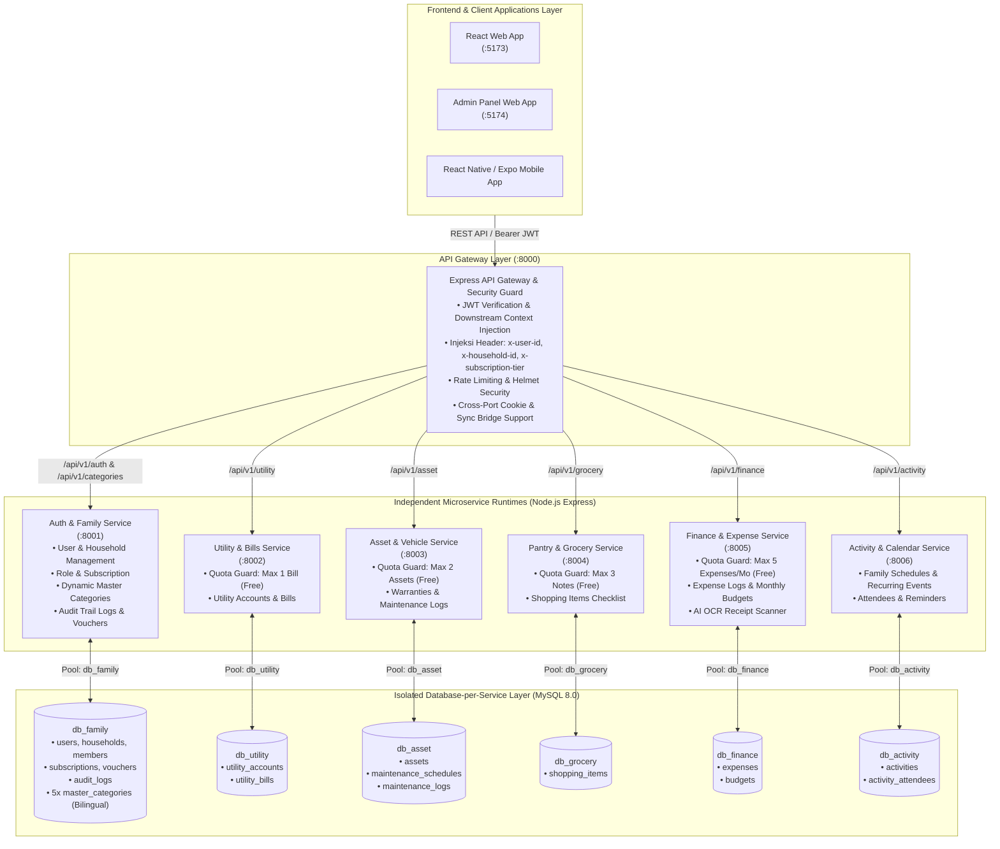
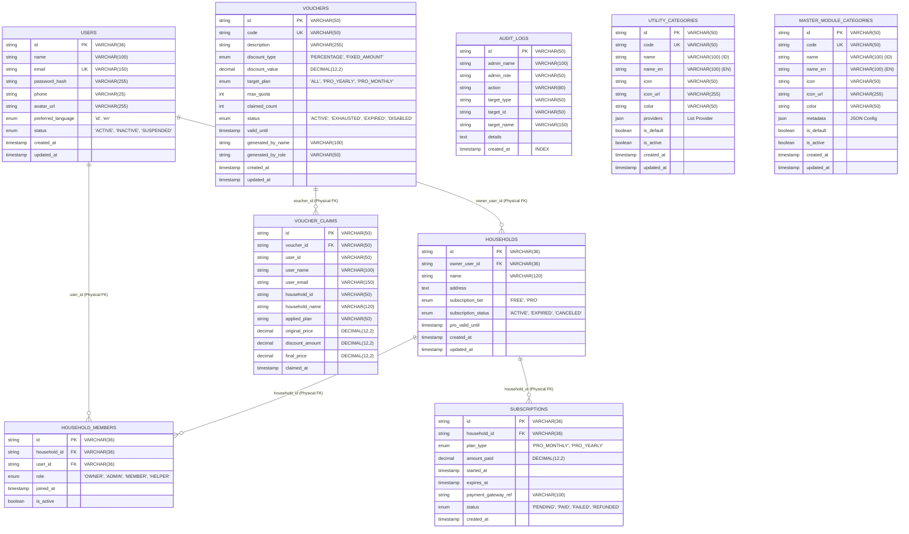
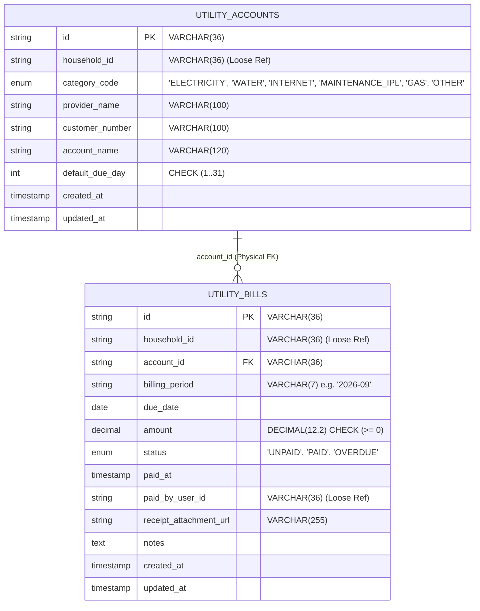
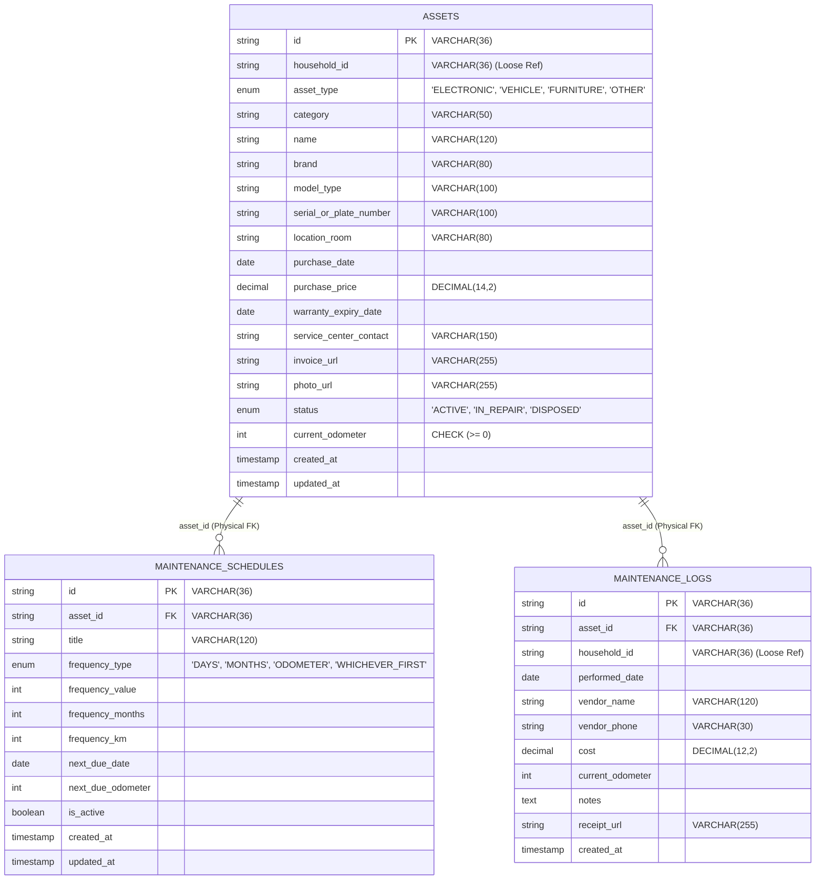
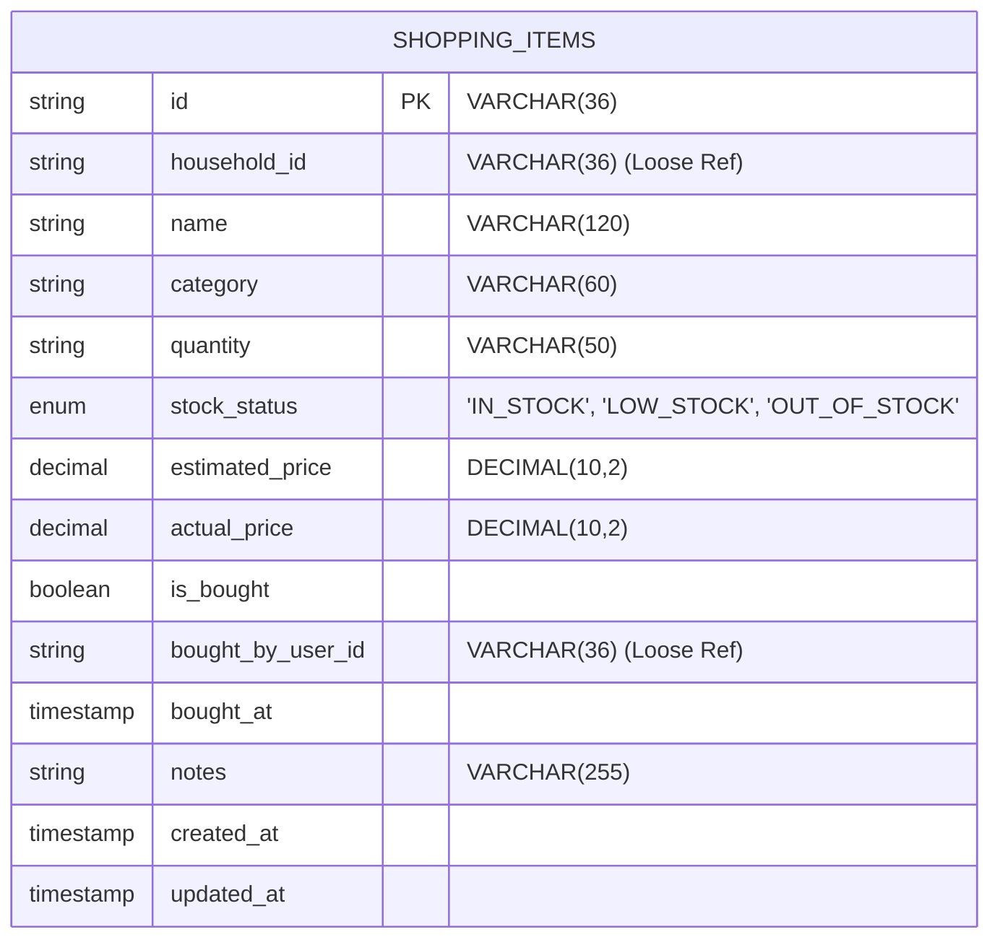
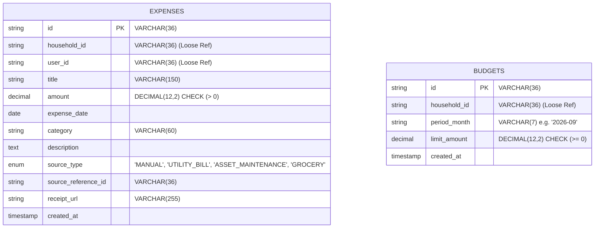
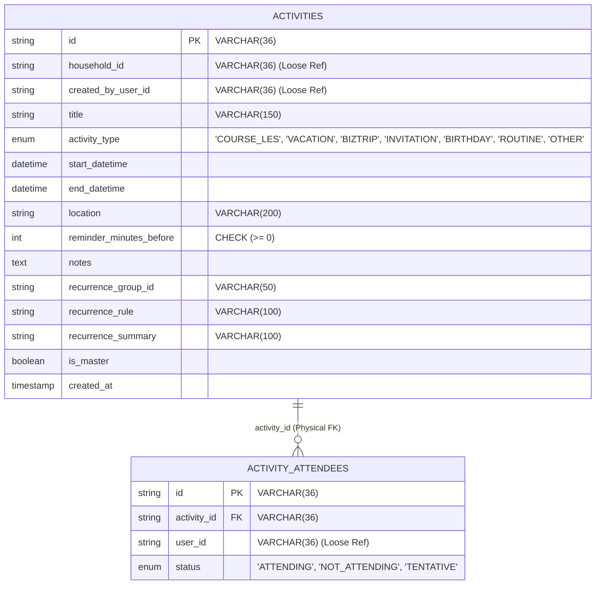

# Arsitektur Database & Relasi Microservices HomeHub
## Pola Bounded Context, Database-per-Service & Loose Coupling

Dokumen ini merupakan spesifikasi resmi arsitektur basis data dan relasi antarlayanan pada **HomeHub**. Seluruh backend HomeHub menerapkan **Arsitektur Microservices Murni** dengan prinsip **Database-per-Service**, di mana setiap domain bisnis terisolasi dalam basis data dan proses runtime independen tanpa adanya *Physical Foreign Key* lintas batas database.

---

## 1. Diagram Arsitektur Sistem & Isolasi Data



---

## 2. Prinsip Loose Coupling & ID Reference (Zero Cross-DB Foreign Keys)

Dalam arsitektur monolitik tradisional, seluruh tabel disatukan ke dalam satu database besar dengan *Physical Foreign Key* yang mengikat tabel-tabel anak ke tabel `households` atau `users`:

```sql
-- ❌ POLA MONOLITIK (ANTI-PATTERN - TIDAK DIGUNAKAN DI HOMEHUB):
-- Menghubungkan database utility secara langsung ke database family via physical foreign key
ALTER TABLE db_utility.utility_accounts 
ADD CONSTRAINT fk_cross_db_household 
FOREIGN KEY (household_id) REFERENCES db_family.households(id);
```

### ✅ Pola Microservices Murni HomeHub
Di HomeHub, seluruh relasi antar microservice menggunakan **Logical ID Reference (Loose Coupling)**:
1. Setiap microservice downstream (`utility`, `asset`, `grocery`, `finance`, `activity`) menyimpan `household_id VARCHAR(36)` dan/atau `user_id VARCHAR(36)` sebagai **kolom independen tanpa constraint fisik ke database lain**.
2. Service downstream **tidak perlu tahu struktur tabel `users` atau `households`**.
3. **Konteks Keamanan & Identitas Disuplai API Gateway**:
   - API Gateway memvalidasi JWT Bearer token dari pengguna.
   - Gateway mengekstrak identitas pengguna dan rumah tangga yang aktif.
   - Gateway menyuntikkan HTTP header downstream:
     - `x-household-id: <uuid>`
     - `x-user-id: <uuid>`
     - `x-subscription-tier: FREE | PRO`
4. Query di downstream murni memfilter data miliknya sendiri:
   ```sql
   -- ✅ Query terisolasi tanpa JOIN lintas database:
   SELECT * FROM utility_accounts WHERE household_id = ?;
   SELECT * FROM expenses WHERE household_id = ? AND expense_date >= ?;
   SELECT * FROM activities WHERE household_id = ? ORDER BY start_datetime ASC;
   ```

---

## 3. Spesifikasi Lengkap Skema ERD per-Microservice

### 3.1 `db_family` (Auth, Family, Subscriptions, Audit Logs & Master Categories)



---

### 3.2 `db_utility` (Utility & Bills Service)



---

### 3.3 `db_asset` (Asset, Vehicle & Maintenance Service)



---

### 3.4 `db_grocery` (Pantry & Grocery Service)



---

### 3.5 `db_finance` (Finance & Expense Service)



---

### 3.6 `db_activity` (Activity & Calendar Service)



---

## 4. Matriks Komprehensif Relasi Antar-Service

| Entitas Sumber | Kolom Kunci Sumber | Entitas Target | Service Target | Metode Relasi | Deskripsi Alur Bisnis |
| :--- | :--- | :--- | :--- | :--- | :--- |
| `households` (`db_family`) | `id` | `utility_accounts` | Utility Service | Logical ID (`household_id`) | Menghubungkan akun tagihan ke rumah tangga pemilik. |
| `households` (`db_family`) | `id` | `assets` | Asset Service | Logical ID (`household_id`) | Menghubungkan inventaris barang/kendaraan ke rumah. |
| `households` (`db_family`) | `id` | `shopping_items` | Grocery Service | Logical ID (`household_id`) | Memfilter daftar belanja sesuai rumah tangga aktif. |
| `households` (`db_family`) | `id` | `expenses` | Finance Service | Logical ID (`household_id`) | Mengelompokkan riwayat pengeluaran kas keluarga. |
| `households` (`db_family`) | `id` | `activities` | Activity Service | Logical ID (`household_id`) | Menampilkan agenda kalender keluarga yang bersangkutan. |
| `users` (`db_family`) | `id` | `expenses` | Finance Service | Logical ID (`user_id`) | Mencatat siapa anggota keluarga yang mengeluarkan uang. |
| `users` (`db_family`) | `id` | `shopping_items` | Grocery Service | Logical ID (`bought_by_user_id`) | Menandai anggota keluarga yang membelanjakan barang. |
| `users` (`db_family`) | `id` | `activities` | Activity Service | Logical ID (`created_by_user_id`) | Menandai anggota keluarga yang membuat agenda. |
| `users` (`db_family`) | `id` | `utility_bills` | Utility Service | Logical ID (`paid_by_user_id`) | Mencatat siapa yang melunasi pembayaran tagihan. |
| `utility_bills` (`db_utility`) | `id` | `expenses` | Finance Service | Logical Ref (`source_reference_id`) | Tagihan yang telah dibayar otomatis tercatat ke pembukuan pengeluaran (`source_type = 'UTILITY_BILL'`). |
| `maintenance_logs` (`db_asset`)| `id` | `expenses` | Finance Service | Logical Ref (`source_reference_id`) | Biaya servis kendaraan/AC otomatis tercatat ke pengeluaran (`source_type = 'ASSET_MAINTENANCE'`). |

---

## 5. Fitur Monetisasi & Batasan Kuota (Quota Guard Enforcement)

Sistem menerapkan pembatasan penggunaan berbasis tier langganan yang diverifikasi pada lapisan middleware (`shared/src/middleware/quotaGuard.js`):

| Modul Layanan | Batasan Paket FREE | Fitur Paket PRO | Mekanisme Guard di Database |
| :--- | :--- | :--- | :--- |
| **Multi-Household** | Maksimal **1 Rumah** | **Unlimited Rumah** | Dicek pada `POST /api/v1/auth/households` via `COUNT(*) FROM households WHERE owner_user_id = ?`. |
| **Anggota Keluarga** | Maksimal **5 Anggota** | **Unlimited Anggota** | Dicek pada `POST /api/v1/auth/households/:id/members`. |
| **Tagihan Utilitas** | Maksimal **1 Akun Tagihan** | **Unlimited Tagihan** | Query `SELECT COUNT(*) FROM utility_accounts WHERE household_id = ?` harus `< 1` untuk tier Free. |
| **Aset & Kendaraan** | Maksimal **2 Aset** | **Unlimited Aset** | Query `SELECT COUNT(*) FROM assets WHERE household_id = ?` harus `< 2` untuk tier Free. |
| **Daftar Belanja** | Maksimal **3 Item Aktif** | **Unlimited Belanja** | Query `SELECT COUNT(*) FROM shopping_items WHERE household_id = ?` harus `< 3` untuk tier Free. |
| **Pengeluaran Bulanan**| Maksimal **5 Transaksi / Bulan** | **Unlimited Transaksi** | Query `SELECT COUNT(*) FROM expenses WHERE household_id = ? AND MONTH(expense_date) = ?` harus `< 5`. |
| **AI OCR Struk** | **Dinonaktifkan (Locked)** | **Akses Penuh Gemini 1.5** | Tombol scan OCR di-guard pada client dan diverifikasi di gateway. |

---

## 6. Ringkasan Perbandingan: Monolith Tradisional vs Microservices HomeHub

| Dimensi | Arsitektur Monolitik Tradisional | Arsitektur Microservices HomeHub Saat Ini |
| :--- | :--- | :--- |
| **Proses Aplikasi** | 1 proses Node.js monolitik tunggal. | **7 proses runtime independen** di port terpisah (:8000 sampai :8006). |
| **Koneksi Database** | 1 connection pool tunggal (`mydb`). | **6 koneksi pool terpisah** (`db_family`, `db_utility`, `db_asset`, `db_grocery`, `db_finance`, `db_activity`). |
| **Relasi Antartabel** | `FOREIGN KEY` fisik ketat lintas semua tabel. | **Nol Physical FK Lintas DB**. Murni menggunakan string UUID reference. |
| **Query Data** | `JOIN users`, `JOIN households`, `JOIN accounts`. | **Nol Cross-DB JOIN**. Pemfilteran murni via Header Context Gateway. |
| **Kategori Master** | Statis di hardcode frontend / tabel tunggal. | **Master Kategori Dinamis Dwibahasa (Bilingual Hybrid)** di MySQL `db_family` dengan sinkronisasi instan ke seluruh client. |
| **Audit & Log** | Tidak ada atau tercampur di log teks file. | **Dedicated `audit_logs` table** dengan pagination efisien untuk jejak operasional admin. |
| **Fault Isolation** | Error di modul aset bisa menjatuhkan modul login. | Crash di `asset-service` tidak berdampak pada transaksi di `finance-service` atau `utility-service`. |
